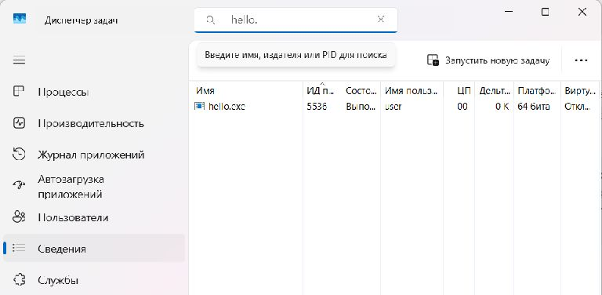
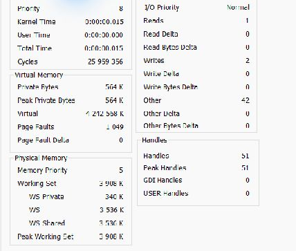
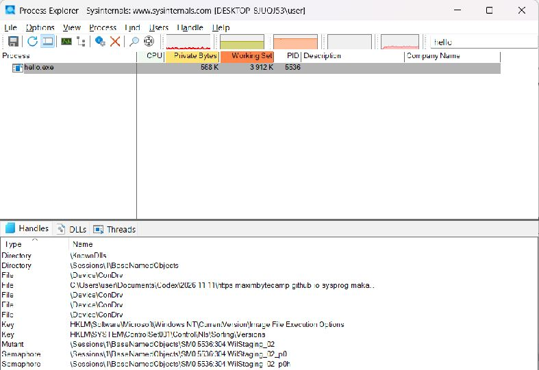
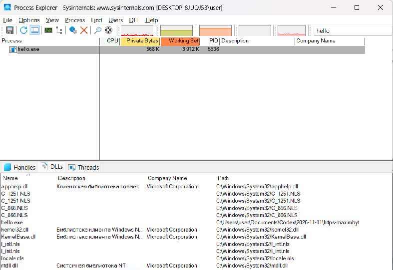
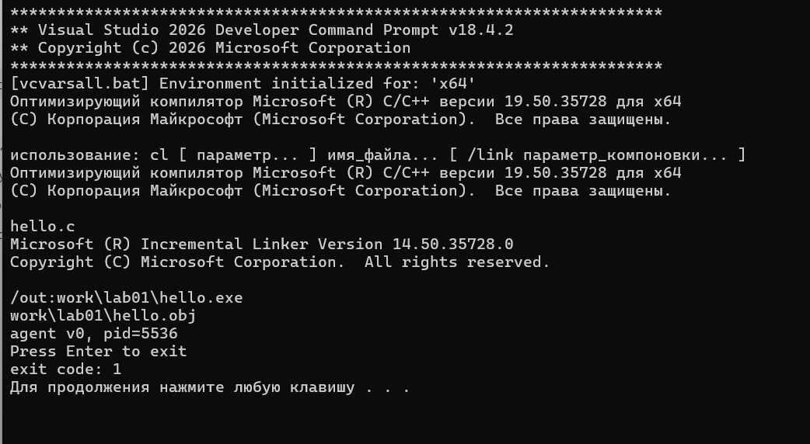
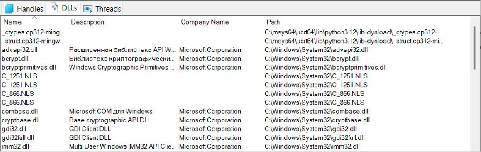
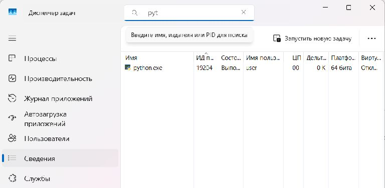
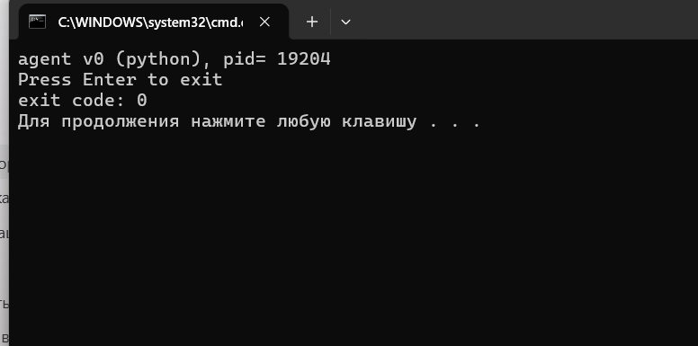

# ЛР 1. Процесс изнутри

1. Собрал hello.c компилятором MSVC 19.50 для Windows x64. Программа вывела PID 5536, полученный через GetCurrentProcessId, и ожидала Enter.

2. В Диспетчере задач hello.exe отображался с тем же PID 5536 и платформой «64 бита».

3. В Process Explorer рабочий набор C составил 3 908 КБ, а частная память — 564 КБ. Процессорное время составило 0,015 с. Пока getchar ждёт ввода, поток блокируется и CPU практически не расходуется.

4. У hello.exe было 51 открытых дескрипторов. Среди них путь к папке запуска и объекты консольного устройства \Device\ConDrv.

5. Процесс загрузил apphelp.dll, kernel32.dll, KernelBase.dll и ntdll.dll.

6. После команды «Снять задачу» для hello.exe оболочка показала код завершения 1.

7. Python 3.12.11 запустил hello.py как python.exe с PID 19204. Рабочий набор составил 12 920 КБ, а частная память — 6 296 КБ. По рабочему набору Python занял примерно в 3,31 раза больше памяти, чем C. Помимо общих системных библиотек, Python загрузил библиотеку libpython3.12.dll и модули интерпретатора.

8. После Enter Python завершился с кодом 0. PID 19204 виден в консоли и Диспетчере задач.

В кадрах 1 и 6 показана одна запись консоли после завершения C. В ней видны вывод сборки, PID и код выхода. Сама команда сборки в кадр не попала. PID Python в консоли и мониторе показан на отдельных снимках.

ИИ: Codex помог выполнить проверки и оформить отчёт.

[Отчёт Word](report.docx)

## Снимки

