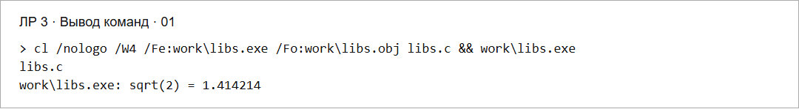
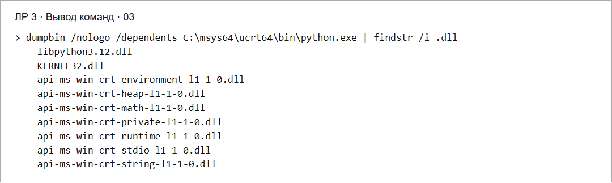
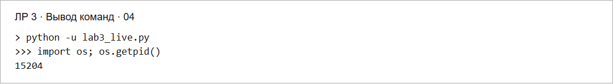
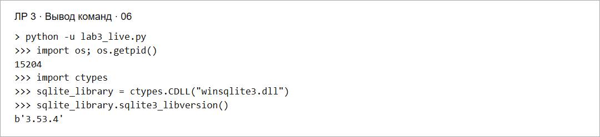
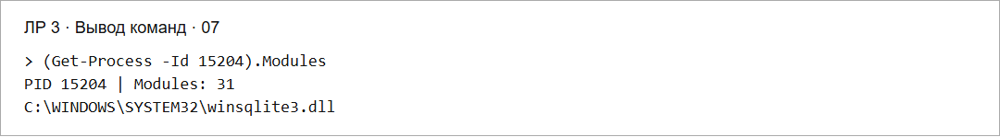

# ЛР 3. Библиотеки программы

1. Собрал libs.c компилятором MSVC и запустил программу. Она вычислила sqrt(2) = 1.414214.

2. Dumpbin показал одну прямую зависимость libs.exe: KERNEL32.dll. Математическая функция входит в статически подключённую библиотеку C.

3. У python.exe видны libpython3.12.dll, KERNEL32.dll и семь библиотек api-ms-win-crt. Интерпретатор использует динамическую библиотеку Python 3.12.

4. Запустил Python 3.12.11 и получил PID 15204 через os.getpid().

5. Перед загрузкой SQLite в процессе было 30 модулей. Среди них не было winsqlite3.dll.

6. Загрузил winsqlite3.dll через ctypes.CDLL. Функция sqlite3_libversion вернула 3.53.4.

7. После загрузки число модулей выросло до 31. В списке появился C:\WINDOWS\SYSTEM32\winsqlite3.dll. Таким образом, список модулей процесса может меняться во время работы.

На снимках показан сохранённый вывод команд с этого компьютера.

Кадры показывают фактический вывод команд, сохранённый и отображённый в браузере. Снимки окна терминала пока отсутствуют.

ИИ: Codex помог выполнить проверки и оформить отчёт.

[Отчёт Word](report.docx)

## Снимки

