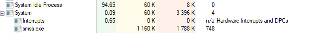
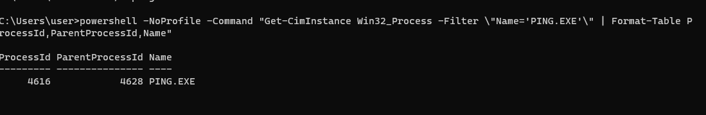
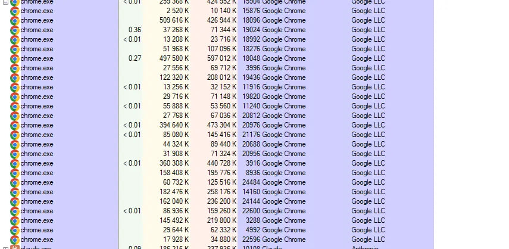
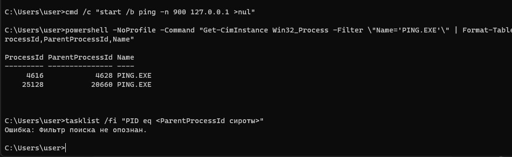

# ЛР 4. Дерево процессов

1. В системной части списка видны System Idle Process, PID 0, и System, PID 4. Idle отражает простой процессора; его нельзя считать обычной родительской программой, запускающей приложения. В Windows нет единого аналога Unix PID 1 для всех осиротевших процессов.

2. Наблюдаемая цепочка запуска оболочки: explorer.exe (8704) → ChatGPT.exe (17792) → codex.exe (18968) → pwsh.exe (20032) → cmd.exe (15524). Это цепочка именно данного запуска через терминальный инструмент. У explorer.exe записан PPID 10124, но такой процесс не найден в том же снимке: цепочку дальше не достраивал.

3. Из cmd.exe запущен ping -n 600 127.0.0.1 в фоне. Номер ребёнка 15936, номер родителя 15524. Оболочка остаётся работающей благодаря режиму /k.

4. Связь проверена через Get-CimInstance Win32_Process: поля ProcessId и ParentProcessId показывают 15936 и 15524 соответственно. Команду и выборку по собственному PID содержит скрипт, поэтому посторонние ping не смешиваются с опытом.

5. У Microsoft Edge найдено 17 процессов с именем msedge.exe: главный 13912 и 16 непосредственных потомков. Отдельные процессы обслуживают разные задачи браузера; по одному имени процесса нельзя установить, какая именно вкладка или подсистема ему принадлежит.

6. Временная оболочка 7108 запустила ping 4968 и завершилась. Проверка наличия родителя вернула False, но у ребёнка сохранился ParentProcessId = 7108. Windows не переписывает этот номер на PID 1.

7. Вывод: PPID хранит номер процесса, создавшего ребёнка, и не гарантирует, что родитель ещё работает. Поэтому для поиска сироты нужно дополнительно проверять существование родителя; следует учитывать также повторное использование PID системой.

ИИ: Codex помог выполнить проверки и оформить отчёт.

[Отчёт Word](report.docx)

## Снимки

