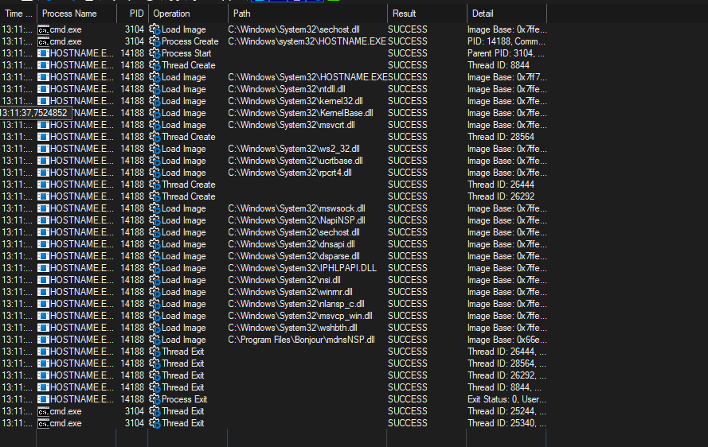
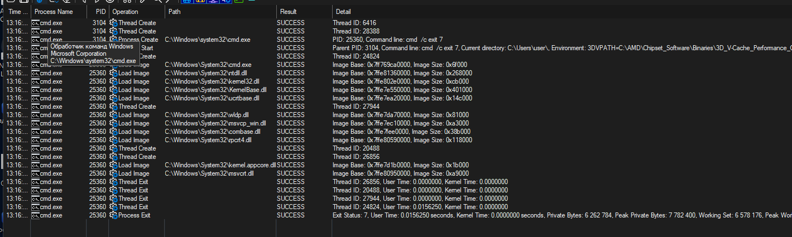
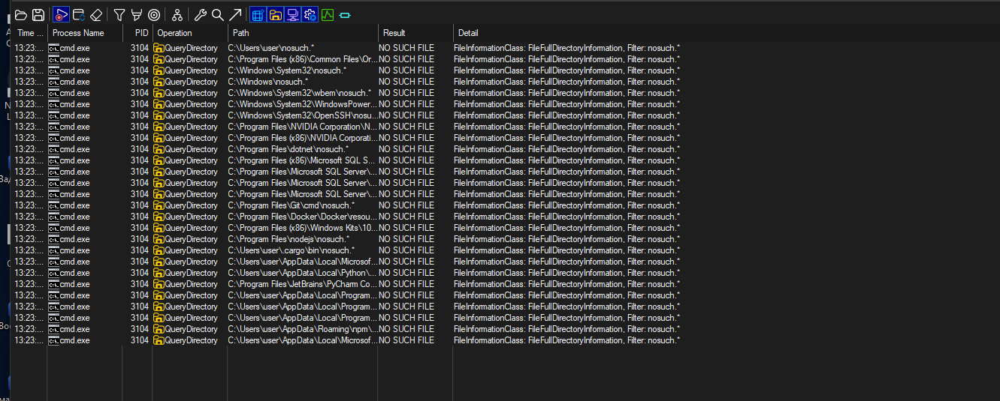
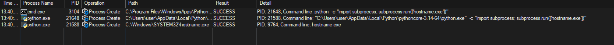

# ЛР 5. Рождение процесса

1. При выполнении hostname родителем был cmd.exe, PID 26472, ребёнком — HOSTNAME.EXE, PID 22108. У родителя записано Process Create, у ребёнка — Process Start с Parent PID: 26472. Команда вывела имя компьютера DESKTOP-8JUQJ53.

2. Загружено 18 DLL. Первой появилась ntdll.dll, затем kernel32.dll, KernelBase.dll, msvcrt.dll, ws2_32.dll, ucrtbase.dll, rpcrt4.dll, mswsock.dll, NapiNSP.dll, sechost.dll, dnsapi.dll, dsparse.dll, IPHLPAPI.DLL, nsi.dll, winrnr.dll, nlansp_c.dll, msvcp_win.dll, wshbth.dll. Загрузка самого EXE в это число не включена.

3. Последовательно выполнены cmd /c exit 7 и echo code %errorlevel%. Родитель 27244 получил code 7; у ребёнка 16132 журнал показывает Process Exit с Exit Status: 7. Код ребёнка и собственный код последующего завершения родителя — разные величины.

4. При запуске отсутствующей команды nosuch процесс cmd.exe 24852 выполнил 56 операций QueryDirectory. Проверено 27 различных каталогов, включая текущий, то есть 26 различных каталогов PATH. Повторы объясняются двумя проходами и повторяющимся каталогом в PATH. Зафиксирован результат NO SUCH FILE, оболочка вернула 9009. Это код оболочки; он не равен справочному Win32 ERROR_FILE_NOT_FOUND = 2.

5. При запуске из Python 3.12.11 родителем стал python.exe, PID 25656, ребёнком — hostname.exe, PID 5888. Ребёнок завершился с кодом 0, тот же код получил subprocess.run. Вместо оболочки родителем теперь является интерпретатор; механизм создания процесса Windows остаётся тем же.

6. Вывод: создание, загрузка образов и завершение — отдельные наблюдаемые события. Process Monitor фиксирует их, но сам по себе не является трассировкой вызовов CreateProcessW, WaitForSingleObject или GetExitCodeProcess.

ИИ: Codex помог выполнить проверки и оформить отчёт.

[Отчёт Word](report.docx)

## Снимки

