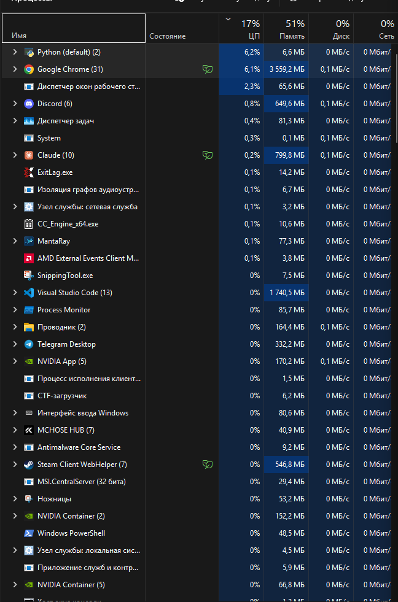
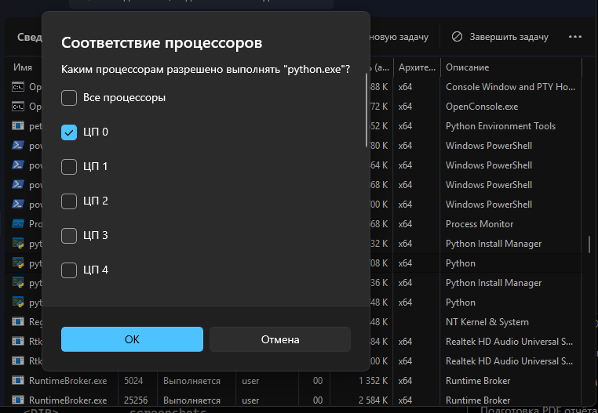
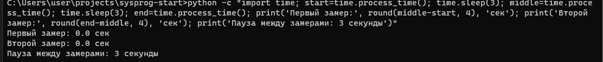

# ЛР 6. Кто загружает процессор

1. На компьютере 12 логических процессоров. Запустил один процесс Python с пустым циклом. За 5,52 с его процессорное время увеличилось на 5,52 с, что соответствует почти полной загрузке одного логического процессора.

2. Два процесса за 5,55 с получили 5,45 и 5,39 с процессорного времени. Вместе они использовали мощность примерно двух логических процессоров.

3. После установки маски привязки 1 оба процесса делили ЦП 0. За 5,48 с они набрали 2,67 и 2,61 с процессорного времени.

ИИ: Codex помог выполнить проверки и оформить отчёт.

[Отчёт Word](report.docx)

## Снимки

