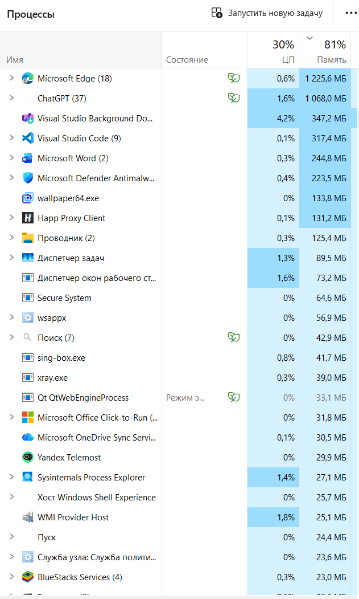
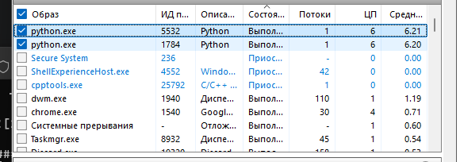
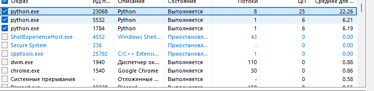
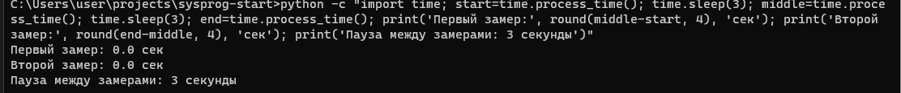

# ЛР 7. Потоки Python и GIL

1. Сравнил обычную и free-threaded сборки CPython 3.14.0. В каждом запуске программа выполняла 200 миллионов итераций, распределяя работу между 1, 2 или 4 потоками.

2. Обычная сборка с GIL выполнила работу за 10,62 / 11,21 / 11,53 с. Дополнительные потоки не ускорили этот вычислительный цикл.

3. Без GIL результаты составили 8,88 / 4,48 / 2,96 с. Четыре потока выполнили работу примерно втрое быстрее одного в той же сборке.

4. При повторном включении GIL в свободнопоточной сборке получено 8,86 / 9,44 / 16,25 с. Проверка sys._is_gil_enabled() вернула True.

5. Один и четыре потока с time.sleep(2) завершились за 2,00 с. Ожидание потоков перекрывается по времени.

ИИ: Codex помог выполнить проверки и оформить отчёт.

[Отчёт Word](report.docx)

## Снимки

