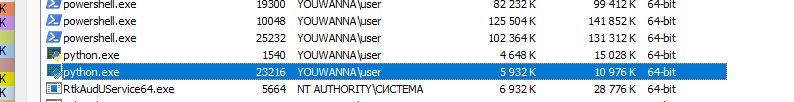
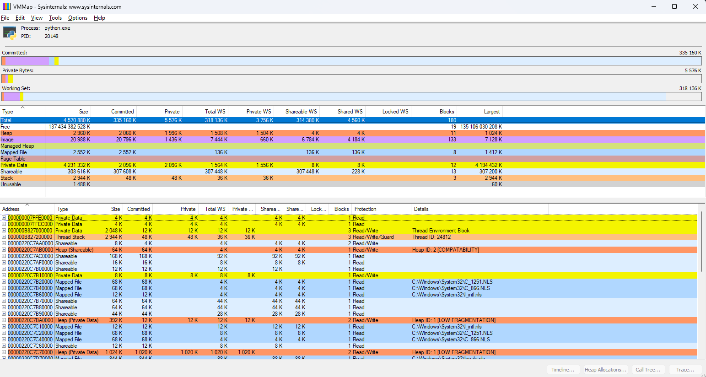
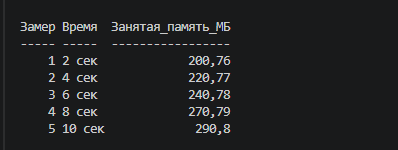

# ЛР 8. Карта памяти

1. Измерил виртуальную память и рабочий набор Python через Get-Process. На старте рабочий набор составлял 14,36 МиБ.

2. Создание отображения размером 300 МиБ увеличило виртуальное адресное пространство на 300 МиБ. Рабочий набор остался около 14,36 МиБ.

3. Запись в каждую страницу подняла рабочий набор до 314,36 МиБ. После закрытия отображения он вернулся к 14,37 МиБ.

4. В опыте с удержанием буферов каждые две секунды частная память прибавляла примерно 20 МиБ. Через 10 секунд она достигла 108,45 МиБ. Буферы продолжали занимать память, потому что ссылки на них оставались в списке.

ИИ: Codex помог выполнить проверки и оформить отчёт.

[Отчёт Word](report.docx)

## Снимки

