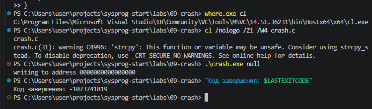
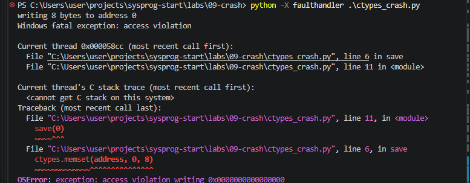
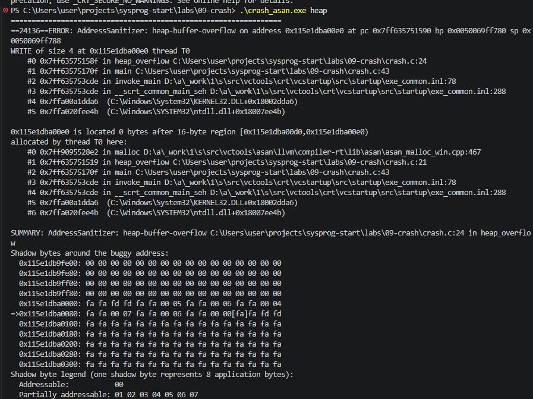
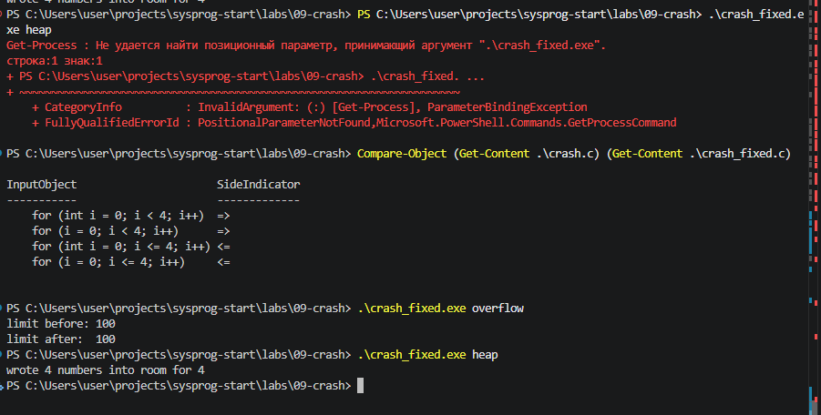

# ЛР 9. Разбор падения

1. Режим null попытался записать 42 по нулевому адресу. Процесс завершился с 0xC0000005 (3221225477 без знака; -1073741819 как signed 32-bit): нарушение доступа к памяти.

2. ctypes_crash.py попытался записать восемь байт по адресу 0. faulthandler напечатал Windows fatal exception: access violation и стек write_bytes, строка 8. Затем ctypes преобразовал Windows-исключение в OSError: exception: access violation writing 0x0000000000000000. Поэтому итоговый код Python — 1, а не нативный 0xC0000005. Запись Application / Event ID 1000 для этих запусков при проверке не найдена; системный журнал не используется как подтверждение.

3. В режиме overflow поле boundary изменилось со 100 на 7, хотя код завершения равен 0. Цикл использует cursor <= 4 и пишет пятый элемент массива из четырёх; в этой сборке запись затронула соседнее поле структуры. Это неопределённое поведение, а не гарантированный результат для любого компилятора.

4. Режим heap без проверки вывел stored 5 values; allocated space for 4 и завершился с кодом 0. AddressSanitizer обнаружил heap-buffer-overflow, запись размером 4 байта, строка 25 в crash.c. Адрес расположен сразу за выделенной областью размером 16 байт. Код версии с проверкой — 1.

5. В режиме uaf AddressSanitizer обнаружил heap-use-after-free. Строка 34 освобождает память, строка 35 использует её при печати. Внутри обработки строки зарегистрировано чтение размером 2 байта. Обычная сборка в этом запуске закончилась с кодом 0; это не доказывает корректность обращения к освобождённой памяти.

6. В crash_fixed.c оба условия заменены на cursor < 4. Печать строки перенесена перед free, а запись через нулевой указатель заменена записью в действительный локальный объект. Все четыре режима исправленной программы проверены с AddressSanitizer и завершились с кодом 0. В overflow граница осталась 100; в heap записано ровно 4 числа; режим uaf напечатал valid label: probe до освобождения.

7. Вывод: успешное завершение не исключает повреждения памяти. Санитайзер обнаруживает ошибки, которые могут оставаться незаметными в обычном запуске; исправлять нужно границы и срок жизни объектов.

ИИ: Codex помог выполнить проверки и оформить отчёт.

[Отчёт Word](report.docx)

## Снимки

